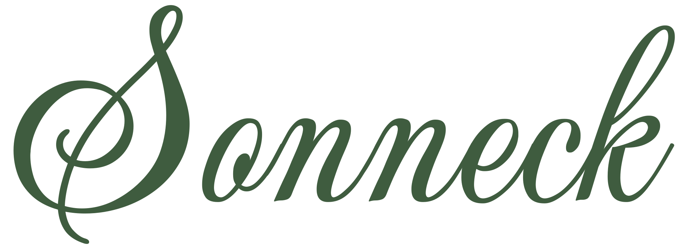

<p align="center">
  <picture>
    <source media="(prefers-color-scheme: dark)" srcset=".github/assets/wordmark-dark.svg">
    <source media="(prefers-color-scheme: light)" srcset=".github/assets/wordmark-light.svg">
    
  </picture>
</p>

<p align="center">
  <a href="https://github.com/jpcranford/sonneck/blob/main/go.mod"></a>
  <a href="https://github.com/jpcranford/sonneck/actions/workflows/docker-publish.yml"></a>
  <a href="https://github.com/jpcranford/sonneck/releases/latest"></a>
  <a href="https://github.com/jpcranford/sonneck/releases"></a>
</p>

An intuitive sheet music organizer app. Import, tag, browse, and download music pieces and books. Made by a musician, for musicians.

## Features
Sonneck is a bookshelf for your sheet music, whether you have public domain classics or the newest pop hits. It's currently designed to be a fancy way of replacing a folder of PDFs, but there are [plans](#planned-features) to add more practice-session features later to turn it into a more well-rounded app.

- **Organize your sheet music library.** Upload individual pieces or entire books — the built-in book splitter and metadata inheritance make quick work of prepping a whole book's worth of pieces to be found later.
- **Use it from anywhere.** Any device with a browser can use every feature of Sonneck, with everything you do saved to the library. Edit metadata on your phone, mark up your score on your tablet (coming soon), or build a setlist on your computer.
- **Composers and arrangers are real people, not text fields.** Each one gets their own page — portrait, bio, birth/death years, and every piece and book they're credited on — browsable from a dedicated People library. A piece or book can credit more than one composer or arranger, in the right order (think "Rodgers and Hart" or a hymn with a separate composer and arranger).
- **Metadata that works for you.** Record key(s), instruments, sheet type, opus number, ISBN, and your own tags, plus a one-click citation generator that collects it all for you. Give it an IMSLP catalog number and it'll auto-fill composer, opus number, year, and publisher for you. The citation line adapts to show only the fields you've actually filled in, and descriptions/user notes support Markdown — including shortcode music symbols like `:mf:` for a mezzo-forte marking (see the [emoji doc](docs/music-emoji.md) for the full list).
  - **Book-to-piece inheritance.** Set a book's composer, publisher, and year once. Every piece inside it inherits the information automatically, you only ever need to override the pieces that are actually different.
  - **Public domain badge.** A small badge shows whether a piece is Public Domain, Likely Public Domain, Copyleft, or In Copyright — computed automatically from the copyright year and composer death year(s) where possible, or set explicitly when you know better. See [Public domain badge](#public-domain-badge) below for how the calculation works and its limitations.
- **Search that keeps up with you.** Full-text fuzzy search across your whole library as you type. Grid views are optimized for number of items shown at once, while list views show you the most detail about each piece without having to open it up.
- **Track your wishlist.** Ever forget you were learning a piece only to rediscover it weeks later at the bottom of your bag? Or buy new pieces to learn, only for them to get lost in the stacks? No more! Use the practice status and filter views to track what you want to play, what you have in progress, and even the stuff you never want to touch again! Take *that*, [Sorabji](https://www.youtube.com/watch?v=_OrAewTxBrc)!
- **Plan your sets.** Setlists can contain a gig date, title, description, and any number of pieces and custom entries that you require. Check the auto-calculated total duration and page count from its details page, reorder things to flow better, and even export the entire set as one combined PDF for convenient backup to another device. Need the program for a bulletin or a group chat? Copy it in one click as Markdown or plain text, complete with every piece's citation.
- **A truly *responsive* workflow.** None of that "resize-and-rerender-everything" lag. Resize and it's good to go, instantly. Useful keyboard shortcuts throughout — hold `/` or `?` on any page to see them — plus right-click (desktop)/long-press (mobile) context menus for quick edits. Drag and drop a file to upload it, no matter what page you're on.
- **Easy on the eyes.** Light, dark, or follow your device. Dark mode even goes for your sheet music (if you want it to): turn on Dark Mode Scores in User Settings and pages render as light ink on a dark background, so a late-night practice session doesn't feel like staring into the sun.
- **It's completely yours.** Self-hosted, one SQLite file, daily automatic backups. No algorithm, no callbacks to some centralized analytics server. It’s a tool for you: use it, break it, repurpose it, join us (or don’t) in making it better, or even leave– a full CSV export is available at any time. If Sonneck isn't the right place for your music, the information you enter and gather (and the time you take doing so) remains yours.

## Installation

There are two ways of installing Sonneck: there are native Mac and Windows apps for an easier install or you can use Docker, which is recommended if you intend on using SSO or hosting over the web.

### Native apps (macOS/Windows)
Grab the latest installer from the [releases](https://github.com/jpcranford/sonneck/releases) page and open it up. On a Mac, that's a `.dmg`: drag Sonneck onto the Applications folder beside it. On Windows, run the installer.

On first launch you'll pick where your library lives (defaults to a `Sonneck Library` folder inside your Music folder) and how you want to sign in. Once in, you'll have the option of going into Admin Settings at any time and using two controls: **Share on Network** (off by default) so you can reach your library on other devices, and a **Library location** control to move or repoint your library to a different folder later.

> [!NOTE]
> These installers aren't code-signed (that costs money per year per platform) so your OS will warn you before the first launch:
> - **macOS**: Gatekeeper will say the app "cannot be opened because it is from an unidentified developer." Right-click (or Control-click) the app and choose **Open**, then confirm **Open** again in the dialog that follows — you only need to do this once. (If you already double-clicked it and got a plain "can't be opened" message with no Open option, go to **System Settings → Privacy & Security**, scroll down, and click **Open Anyway** next to the Sonneck mention.)
> - **Windows**: SmartScreen will say "Windows protected your PC." Click **More info**, then **Run anyway**.
>
> This is expected behavior for any unsigned app, but don't worry; every app version is [built](.github/workflows/native-build.yml) directly from this repo's own code by GitHub Actions — nothing hidden happens between the code here and the file you download.

### Docker Compose
There's a [`docker-compose.yml`](docker-compose.yml) file in this repo and copied to each release, complete with helpful comments explaining some common env vars.

Download the file, tailor it how you want, then run:

```sh
cd ./wherever          # containing folder of docker-compose.yml
mkdir data             # create this yourself — see note below
docker compose up -d
```

The compose file takes care of the fiddly bits like remembering where you put your data folder and mounting it to the right place within the container.

**Need a `docker run` command instead?** Grab the compose file, change what you need, then use [Decomposerize](https://www.decomposerize.com/) to convert it.

> [!WARNING]
> **Create the `data` folder yourself before the first run.** If you don't, Docker will create it for you as root when the container starts, which may cause write issues. If you hit a permission error on startup, it's almost always this; fix it by running `sudo chown -R 1000:1000 ./data` on the host machine.

### Running locally
Check the `CONTRIBUTING.md` file for full local run instructions. Here's the TL;DR for those that understand what this means.

Start the backend:
```sh
cd /sonneck   # wherever the repo is
DATA_DIR=./data PORT=8080 go run ./cmd/sonneck
# DATA_DIR *must* be passed somehow or it'll fail.
```

And because that needs to keep running, in a separate terminal run:
```sh
cd /sonneck/frontend
npm run dev
```

## Advanced options
### Configuration
Nearly all configuration can be done via environment variables. These are validated at startup, and the process exits immediately with a clear error if something's invalid e.g. an unparseable cron expression. 

Several of these (`BACKUP_CRON`, `BACKUP_RETENTION_DAYS`, `LOG_LEVEL`, `COPYRIGHT_REGION`) can also be changed live from Admin Settings once you're signed in as an admin — no restart needed. An env var always wins if set (locking that field in Admin Settings); otherwise the value you set through Admin Settings is saved to `config.yml` at the root of your library folder and takes effect immediately.

| Variable | Default | Notes |
|---|---|---|
| `PORT` | `8080` | HTTP listen port. Really only useful for dev work; native apps handle port selection automatically, and if you're using Docker, use port remapping instead. |
| `DATA_DIR` | `/data` | Root of the database, library files, backups, and logs |
| `BACKUP_DIR` | `$DATA_DIR/backups` | Where daily DB snapshots are written |
| `BACKUP_CRON` | `0 3 * * *` | Standard cron expression for the daily backup job |
| `BACKUP_RETENTION_DAYS` | `30` | Backups and logs older than this are pruned at launch |
| `CITATION_FORMAT` | (built-in template) | Reserved for future use. |
| `LOG_LEVEL` | `info` | One of `debug`, `info`, `warn`, `error` (case-insensitive). Turn this up to `debug` on a deployed instance if you need more detail while diagnosing an issue |
| `COPYRIGHT_REGION` | `en-US` | One of `en-US`, `eu-generic`, `en-GB`, `ca` — which region's rule Sonneck's "Likely Public Domain" badge calculation uses. See [Public domain badge](#public-domain-badge) below |
| `AUTH_METHOD` | (unset) | One of `none`, `singlepass`, `oidc` — see [Security](#security) below |

### Security options

> [!CAUTION]
> Sonneck on Docker first launches with no security enabled and open to the network (see [Security](#security) below). Until you enable a password or SSO support, anyone who can reach the server over the network can use the full API, with no separation between "trusted operator" and "anonymous visitor." It should go without saying but **do not expose it on the open internet like this.**

Sonneck supports the following authentication methods, in order of least to greatest security:
1. **No password.** Anyone that can find Sonneck can do anything. One user, full admin. If you're just running this as an app on your computer and not gonna use another device, this is fine.
2. **Password** mode locks the app behind a single password. If you're on a shared computer or planning on using Sonneck on multiple devices, I recommend this option at the very least. I haven't enforced any rules for the password other than length, so make it as simple or complex as makes you feel safe doing.
3. **Sign in with…** (OIDC/SSO) mode, only available on Docker installs. The sign-in page kicks you over to your SSO provider for sign-in, and once you sign in the SSO provider gives Sonneck your name and profile pic. Sonneck Admins can manage user permissions in Admin Settings. IMO this will be overkill for all but the biggest libraries.

On first launch, a setup screen walks you through picking one of the above (OIDC/SSO is greyed out unless it's already configured — see the [OIDC / SSO setup](docs/oidc-setup.md) doc for details). Setting `AUTH_METHOD` yourself locks that screen to your choice instead of leaving it pickable (a `singlepass` password is still entered there either way, since a password itself has no environment-variable equivalent).

#### Authenticating reverse proxies
There's a secret fourth option, which is gating Sonneck behind an authenticating reverse proxy, such as Cloudflare Access, Authelia, or Authentik. How exactly to do it varies by proxy, but you probably will need to let the following files through without a login, since e.g. iOS fetches the home-screen icon without your login cookie and gets the login page instead. They're public images, nothing from your library: 

```
/favicon.svg
/favicon-32x32.png
/apple-touch-icon.png
/icon-192.png
/icon-512.png
/manifest.webmanifest
```

For example, in Cloudflare Access, this is set up as a separate application covering these paths with a **Bypass** policy. The greater specificity for these paths will make it take priority over the main application.

### Public domain badge
A piece's badge is one of four states: **In Public Domain** or **Copyleft** (both set explicitly by you), or **Likely Public Domain** / **In Copyright** (computed automatically). The computed states use a per-region formula, reviewed against IMSLP's [Copyright Made Simple](https://imslp.org/wiki/IMSLP:Copyright_Made_Simple) and [Public domain](https://imslp.org/wiki/Public_domain) pages. `COPYRIGHT_REGION` (above) picks which region's rule applies to your whole library — the U.S. rule is based on the copyright year alone; the EU/UK/Canada rules are based on the composer's death year (falling back to an approximation from the copyright year if no death year is on record).

> [!IMPORTANT]
> **This is not legal advice.** The calculation is a labeled approximation meant to be a useful starting point, not a determination you should rely on without your own judgment. Especially in the US, there are some edge cases that can throw normal rules out the window; the [Hirtle chart](https://commons.wikimedia.org/wiki/Commons:Hirtle_chart#Works_except_sound_recordings_and_architecture) lays out more of those in detail. Verify independently before treating a piece as public domain. To be absolutely sure, consult an appropriate lawyer.

### Backups & logs
**Backup:** Automatic, done as a scheduled job by the database using the above environment variables. Backups can be found at `$BACKUP_DIR/sonneck-YYYY-MM-DD.sqlite` before they're cycled out after a number of days set by env var `BACKUP_RETENTION_DAYS`.

This backs up the **database only**. The `library/` folder (original book PDFs and extracted piece PDFs) is not included; that's on you to back up separately via your own volume/NAS snapshot/rclone-to-Dropbox/etc. mechanism.

**Restore:**
1. Stop the server.
2. Replace `$DATA_DIR/db/sonneck.sqlite` with the desired backup file (e.g. `cp $DATA_DIR/backups/sonneck-2026-08-01.sqlite $DATA_DIR/db/sonneck.sqlite`).
3. Start the server again.

**Logs:** Every log line (the same structured JSON that goes to stdout/`docker logs`) is also written to `$DATA_DIR/logs/sonneck-YYYY-MM-DD.log`, one file per day. Old log files are pruned on the same schedule and to the same `BACKUP_RETENTION_DAYS` window as backups.

### Admin CLI commands
Maintenance actions are exposed as subcommands on the same binary rather than HTTP endpoints, since they're actions for server owners rather than mere admins. They're safe to run against a live server; they rely on SQLite's WAL mode (already enabled) and, where they touch on-disk files, write via a temp-file-then-atomic-rename so a concurrent request never sees a partial result.

If you're using Docker, do
```sh
docker exec -it <container-name> sonneck <command>
```

Or if you're running locally from the repo:
```sh
DATA_DIR=./data go run ./cmd/sonneck <command>
```

| Command | What it does | When to run it |
|---|---|---|
| `rebuild-search-index` | Drops and repopulates the full-text search index (`pieces_fts`) from the database's core tables. | The index is derived data — safe to rebuild any time it's suspected out of sync. |
| `regenerate-thumbnails` | Clears `$DATA_DIR/cache/thumbnails` and re-renders thumbs of every page of every piece from scratch, also sweeping up any orphaned entries left over from deleted pieces. | If cached thumbnails are ever suspected corrupted or stale — no need to know which cache entries are actually bad. |
| `regenerate-thumbnails <piece ID> …` | The same, for just the pieces you name (e.g. `regenerate-thumbnails 12 40`): clears and re-renders only their page thumbnails, leaving the rest of the cache alone. If any ID doesn't match a piece, nothing is touched. A piece's ID is the number in its address, `/pieces/<ID>`. | When you know which piece's thumbnails look wrong, and don't want to rebuild the whole library's. |
| `cleanup-thumbnails` | A lighter touch than `regenerate-thumbnails`: leaves everything that's already correct alone, and only removes cached page images nothing can read anymore (a deleted book/piece's leftovers, or a book's own pages once it's been fully imported into pieces) or re-renders ones that are actually corrupted. | Routine housekeeping — safe to run any time, and if you had a pre-v0.3 library it's worth running once after upgrading to reclaim space from book thumbnails your library accumulated before this existed. |
| `regenerate-pages` | Re-renders the Sheet Viewer's full-size pages (`$DATA_DIR/cache/pages`) for every piece that already has them; a piece never opened in the viewer stays unrendered until it is. | After an upgrade whose notes say pages render differently now, or if a page in the viewer looks wrong. |
| `regenerate-pages <piece ID> …` | The same, for just the pieces you name, whether or not they've been opened yet. | When one piece's pages look wrong. |
| `cleanup-pages` | Removes Sheet Viewer pages nothing can use anymore: pages from an older version of the renderer, pages for files no piece has now, unreadable pages (they render again next time the piece opens) and leftovers from an interrupted render. Everything else stays. | Routine housekeeping — safe to run any time. |
| `reset-password` | Clears the stored password for **Password** mode's shared account, so a fresh one has to be set the next time the server reboots. | If you've forgotten that password. |
| `link-oidc-account <user-id-or-name> <subject>` | Links an existing account to a specific identity-provider identity, without waiting for that person to sign in first. See [OIDC / SSO setup](docs/oidc-setup.md). | If `OIDC_ALLOW_REGISTRATION=false` and you need to pre-provision someone, or to fix an account that got linked to the wrong identity. |
| `export-csv` | Writes a full export of your library data to `$DATA_DIR/export/<timestamp>/` — one CSV file per database table (books, pieces, tags, keys, and so on). Read-only; doesn't touch the database or any existing files. | Any time you want your data out of Sonneck as plain CSV — a one-off backup in a format other tools can read, or just to take it with you. |

## Planned features
- Support for image files, and also support for a folder of image files to be uploaded/assembled into a piece
- **Sheet Viewer!** (In progress: a piece's Play button already opens it full screen, turning pages by tapping either side, swiping or with a Bluetooth page turner, with a clock and stopwatch, brightness/contrast/invert filters remembered per piece, your own notes and practice status a tap away, a Practice List to work through (with a mark for each piece you've practiced today), Play Set for a whole setlist, and annotations: pen, highlighter, text and eraser in six colors you can hide, saved to the server for each account, and downloadable with the piece or a whole setlist as real PDF annotations that other apps can still edit; the rest below is still to come.) The practice view every app like this seems to have, with Bluetooth page turner support, server-saved annotations, and a built-in metronome, possibly with some simple gap support there. Maybe some music theory references too, why not; it's not like the circle of fifths has changed in the last 400 years. Also, possibly, importing PDF annotations for mild cross-compatibility with whatever other tools are used.
- **Folders, both smart and otherwise.** Save filters to be automatic folders of music– think "pieces I've Learned and are solo pieces for the piano" or "lead sheets from books x, y, and z" accessible under a name in the sidebar.
- **Configurable citation format.** Just in case you don't like the defaults.
- Server-side printer support? Unsure about this one, but essentially the server would have a dedicated printer with the same settings saved, boiling a whole process down into a simple "Send to Printer" button. Dunno if this is achievable or just a fever dream.

## About the name
Sonneck is named after **Oscar Sonneck** (1873–1928), an American musicologist and librarian. From 1902 to 1917 he was the first chief of the new Music Division at the Library of Congress, where he built the division's holdings into one of the world's great music collections and devised a classification scheme still in use today, with modifications. In 1915, he founded *[The Musical Quarterly](https://en.wikipedia.org/wiki/The_Musical_Quarterly)*, a music-focused academic journal still around today. Around the same time, he also joined the music publisher G. Schirmer, Inc. \(of [yellow cover fame](https://imslp.org/wiki/Schirmer), now part of Hal Leonard and Wise Music Group\) and later became its vice president in 1921.

He's regarded as the founding figure of American musicology — his bibliographic work on early American music laid the groundwork for the field, and most importantly, his last name sounded great for an app. :wink:

## AI disclaimer

<p align="left">
  <a href="https://aiclscale.org">
    
  </a>
</p>

This has been a series of learning exercises for me while I build a desperately-needed toolkit for my own use. While I had a quite a lot of ideas and built out a meticulously detailed framework, specifications, and guardrails, contributed code and designed assets as I went, and reviewed every line and handled all commits, I used AI for much of the raw building-from-scratch gruntwork and bug-finding (hours of work became mere *seconds!*).

Despite all the caution and guardrails, I still don’t trust it– I don't know what I don't know here, and I’ll gladly welcome the contributions of any human that wants to make this project more secure, reliable, robust, or just plain cleaner.

## Acknowledgements
- My beautiful girlfriend, for helping design the logo
- The frontend serif typeface is [Libre Baskerville](https://github.com/impallari/Libre-Baskerville) by Pablo Impallari, [Google Fonts](https://fonts.google.com/), licensed under the [SIL Open Font License 1.1](https://fonts.google.com/specimen/Libre+Baskerville/license). Self-hosted rather than loaded from Google Fonts at runtime.
- The frontend sans-serif typeface is [Cabin](https://github.com/impallari/Cabin) by Impallari Type and Rodrigo Fuenzalida, also for Google Fonts and licensed under the SIL Open Font License 1.1. Self-hosted rather than loaded from Google Fonts at runtime.
- The Sheet Viewer's clock uses [Atkinson Hyperlegible Next](https://github.com/googlefonts/atkinson-hyperlegible-next) by the Braille Institute of America, for Google Fonts, licensed under the SIL Open Font License 1.1. Self-hosted rather than loaded from Google Fonts at runtime.
- The Sheet Viewer's text marks use [Quintessential](https://fonts.google.com/specimen/Quintessential) by Brian J. Bonislawsky (Astigmatic), for Google Fonts, licensed under the SIL Open Font License 1.1. Self-hosted rather than loaded from Google Fonts at runtime, and embedded in annotated PDF downloads.
- The cursive S logo is taken from the [Gwendolyn](https://github.com/googlefonts/gwendolyn) font's capital S and the rest of the wordmark was built with [Mea Culpa](https://github.com/googlefonts/mea-culpa). Both fonts were designed by Robert Leuschke for Google Fonts and licensed under the SIL Open Font License 1.1. Logo and wordmark rendered as SVG and self-hosted.
- The music symbols supported in Markdown fields (`:forte:`, `:flat:`, `:segno:`, and the rest) render via [Bravura Text](https://github.com/steinbergmedia/bravura), the SMuFL music-notation font from Steinberg Media Technologies, licensed under the SIL Open Font License 1.1. Self-hosted as a tiny subset (a few KB, not the ~3MB full release) containing only the specific glyphs this app supports.
- The fleuron used on generated setlist covers was redrawn from a border printed in *An Exhibit of Garamond Type with Appropriate Ornaments* (Redfield-Kendrick-Odell Co., 1927), although it's a design first shown as one of Caslon's original [flower ornaments](https://archive.org/details/specimenofprinti00caslrich/page/n88/mode/1up), ca. 1785 but possibly from even earlier than that. It's a flower symbol almost as old as Western music, and has been used alongside several serif typefaces across the centuries.
- My inspirations, for showing me what's possible with modern tech. [RomM](https://github.com/rommapp/romm), [Plex](https://www.plex.tv/your-media/), and [Calibre](https://calibre-ebook.com/) stand out.
- Despite some passing resemblance in name, we are in no way affiliated with a certain blue runs-fast creature. Whatever species it claims to be.
